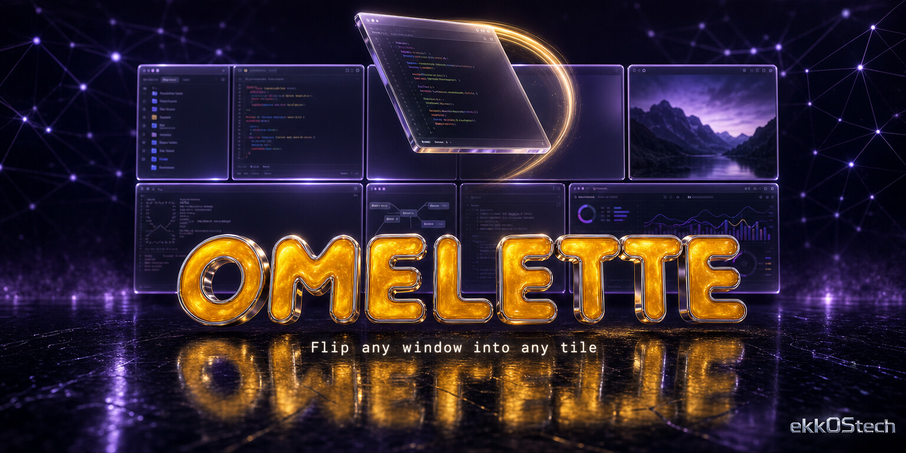
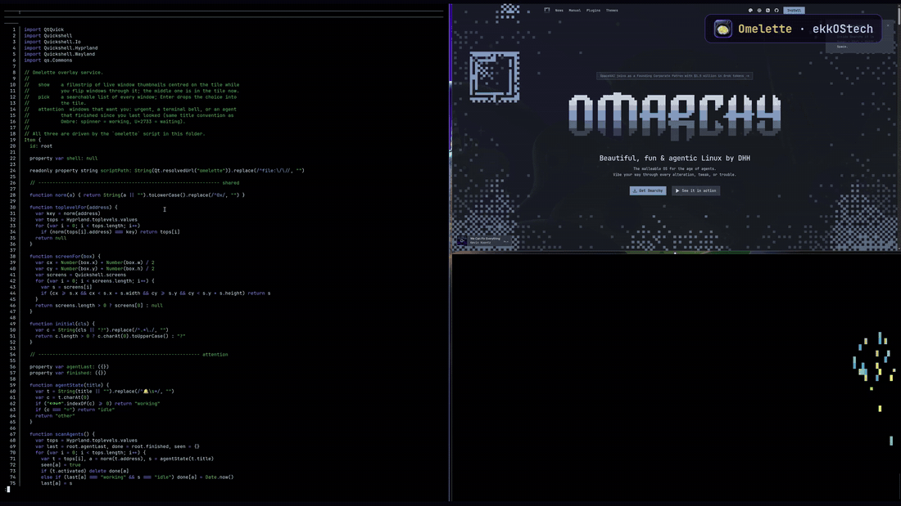
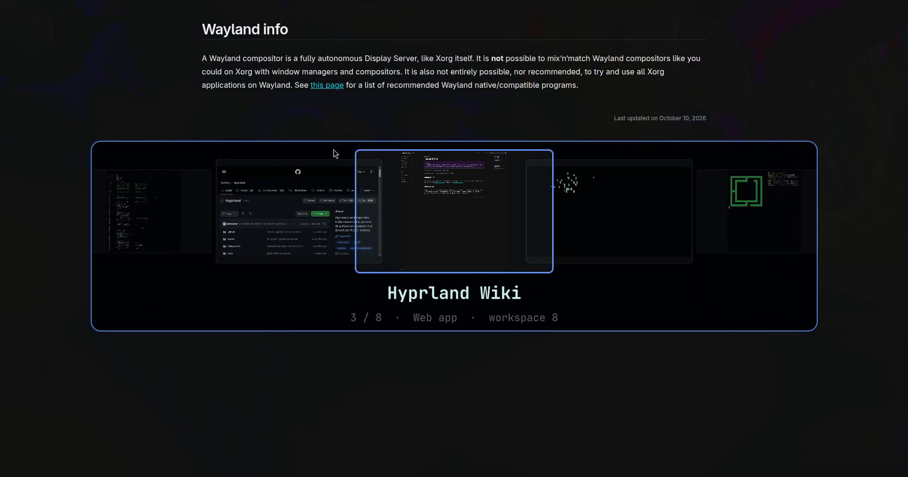
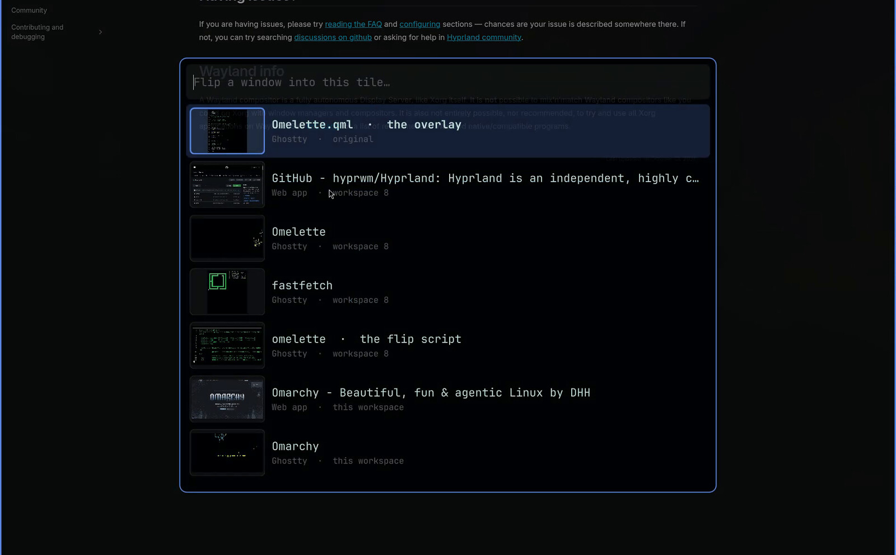

<p align="center">
  
</p>

# Omelette



*Om-let.* You flip an omelette in the pan; this flips windows into the tile you're looking at.

An [Omarchy](https://omarchy.org) shell plugin for tiled desktops that already look
the way you want. Point at a tile, hold **Super + Ctrl** and scroll: every open window
takes its turn in that tile, from any workspace, while the rest of your layout stays
exactly where it is. Stop on the one you want and get to work.



▶ **[Watch the 22-second trailer](https://github.com/ekkostech/omarchy-omelette/releases/download/v1.0.0/omelette-trailer.mp4)**

No more sliding windows around to make room or hunting through workspaces for the one
you need. Keep the layout you like and change what's in it.

## The one-swap rule

Each flip trades the tile's original window with the window being shown. Wherever you
stop, exactly two windows have swapped places: the one you picked moved into the tile,
and the original took its old spot, on whatever workspace that was. Every other window
and split stays put. Scroll all the way round and the original is back where it started.

## Features

- **Scroll to flip**: hold Super + Ctrl and scroll over any tile. No clicking, no focusing first.
- **Live filmstrip**: thumbnails of the windows before and after slide past in the middle of the tile, live even for windows on other workspaces, with the title, app and workspace of the one you're on.
- **Smart order**: windows that want you come first (urgent, a terminal bell, or an agent that finished since you last looked), then windows on other workspaces, then ones already on screen. Most recently used first within each group.
- **Same app only**: add Shift to cycle just the tile's app, like a row of Claude Code or Codex terminals.
- **Search**: Super + Ctrl + / (or Super + Ctrl + middle-click) lists every window with a preview. Type a few letters, press Enter, and it drops into the tile.
- **Undo**: Super + Ctrl + Esc (or Super + Ctrl + right-click) puts the original back.
- **Keyboard too**: Super + Ctrl + Up / Down flips the focused tile.
- **A soft landing**: the incoming window fades in over about 150 ms, without switching on Hyprland's opacity animation for every focus change.
- **Your pointer stays put**: Hyprland warps the cursor when it swaps windows; Omelette puts it back where your hand left it.
- **One-handed, if you like**: hold the mouse's back button and scroll, with a small patch for Wayland-Wheeltani. A plain tap still goes back.
- **Leaves odd windows alone**: floating, fullscreen, grouped, pinned and scratchpad windows are never moved.





## Keys

| Keys | What it does |
| --- | --- |
| <kbd>Super</kbd> + <kbd>Ctrl</kbd> + scroll | Flip the next / previous window into the tile under the pointer |
| <kbd>Super</kbd> + <kbd>Ctrl</kbd> + <kbd>Shift</kbd> + scroll | The same, only windows of the tile's app |
| <kbd>Super</kbd> + <kbd>Ctrl</kbd> + <kbd>↓</kbd> / <kbd>↑</kbd> | Flip the focused tile (add <kbd>Shift</kbd> for the same app) |
| <kbd>Super</kbd> + <kbd>Ctrl</kbd> + <kbd>/</kbd> or middle-click | Search every window and drop one into the tile |
| <kbd>Super</kbd> + <kbd>Ctrl</kbd> + <kbd>Esc</kbd> or right-click | Put the tile's original window back |

In the search panel: type to filter, <kbd>↑</kbd> <kbd>↓</kbd> or <kbd>Tab</kbd> to move,
<kbd>Enter</kbd> to drop the window in, <kbd>Esc</kbd> or a click outside to close.

## Requirements

- **Omarchy 4**, whose Quickshell-based shell runs the plugin.
- **Hyprland 0.55 or newer** with the Lua config Omarchy ships. Tested on 0.56.2.
- **Python 3**, already on every Omarchy install.

## Install

```bash
omarchy plugin add https://github.com/ekkostech/omarchy-omelette.git --enable --yes
~/.config/omarchy/plugins/ekkostech.omelette/omelette setup
omarchy restart shell
```

`omelette setup` adds the shortcuts to `~/.config/hypr/bindings.lua` inside a managed
block. It backs the file up first and skips any combo something else already uses, then
reloads Hyprland. Run it again after an update; `omelette setup --print` shows the block
without writing anything.

## Remove

```bash
~/.config/omarchy/plugins/ekkostech.omelette/omelette setup --remove
omarchy plugin remove ekkostech.omelette --yes
omarchy restart shell
```

`omelette setup --remove` takes the managed shortcuts block back out of
`~/.config/hypr/bindings.lua` (backing the file up first) and reloads Hyprland. Nothing
else is written outside the plugin folder; flip state lives in `$XDG_RUNTIME_DIR` and
disappears at logout.

**Faster wheel (optional).** Hyprland accepts a wheel shortcut at most every 300 ms. To
flip faster, add this to `~/.config/hypr/input.lua` (it also speeds up Omarchy's
Super + scroll workspace switching):

```lua
hl.config({ binds = { scroll_event_delay = 150 } })
```

## One-handed mode (optional)

[Wayland-Wheeltani](https://github.com/docloulou/Wayland-Wheeltani) gives Wayland
Windows-style middle-button autoscroll. `extras/wayland-wheeltani-button-gesture.patch`
adds a `[button_gesture]` section to it: hold a mouse button and turn the wheel to run
commands, while a plain tap is replayed as a normal click. Apply the patch, rebuild, and
add this to its config (commands are run directly, so use absolute paths):

```toml
[button_gesture]
button = "side"   # side = back, extra = forward
on_wheel_up = ["/home/YOU/.config/omarchy/plugins/ekkostech.omelette/omelette", "prev"]
on_wheel_down = ["/home/YOU/.config/omarchy/plugins/ekkostech.omelette/omelette", "next"]
min_interval_ms = 110
```

## Command line

```
omelette next|prev [--focused | --window ADDRESS] [--same-app]
omelette pick      [--focused | --window ADDRESS] [--same-app]
omelette put ADDRESS --window TILE
omelette undo
omelette setup [--print | --remove]
```

Everything the shortcuts do is a plain command, so you can bind it differently, call it
from a script or let an agent drive it.

## How it works

- Hyprland 0.56 can swap two windows across workspaces in one step, and each keeps the
  other's exact place in its layout. Omelette only ever asks for those swaps, which is why
  nothing else moves.
- A flip session remembers the tile, its original window and the order of the rest in
  `$XDG_RUNTIME_DIR/omelette.json`. It lasts while the tile still shows the last window
  flipped in, and for 30 seconds after the last flip.
- The filmstrip and search panel are a Quickshell service. Thumbnails come from
  `hyprland-toplevel-export`, which is why windows on hidden workspaces show up live.
- Agent status follows the same title convention as [Ombre](https://github.com/ekkostech/omarchy-ombre):
  a spinner means working, ✳ means waiting, and a 🔔 means the terminal rang its bell.

## Development

```bash
python3 -m unittest discover -s tests
```

The tests drive a fake compositor through thousands of random flips and check the
one-swap rule after every step, plus the ordering, naming and `setup` behaviour.

## More from ekkOStech

- [Ombre](https://github.com/ekkostech/omarchy-ombre): shade each terminal its own way.
- [Cockpit](https://github.com/ekkostech/omarchy-cockpit): every repo, worktree and agent terminal in one overlay.

The banner and icon were made with ChatGPT image generation.

## License

MIT
